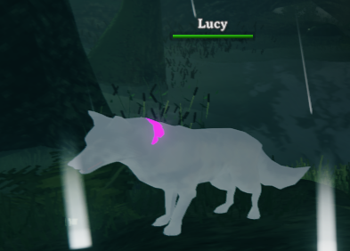
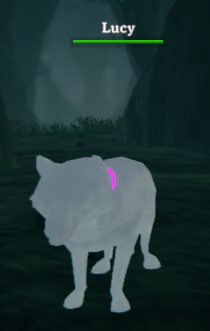

# Lucy - Valheim Companion

## Screenshots

Lucy in-game:





## Software technologies used

- .NET target: .NET Standard 2.1
- C# language version: latest (`<LangVersion>latest</LangVersion>`)
- Mod framework: BepInEx (loaded from the local Valheim BepInEx install and referenced as `BepInEx.dll`)
- Harmony runtime: 0Harmony (referenced from `$(BepInExDir)\core\0Harmony.dll`)
- Valheim runtime: the project compiles against the installed Steam Valheim assemblies (`assembly_valheim.dll` and Unity engine DLLs from the local game install)

## Current stage

**Version 0.40.0 — stable production release.** Lucy uses Valheim's animated wolf creature, defends the player and herself from nearby threats, gathers nearby drops and harvestable plants, and has a white coat, eye patch, and purple collar. Combat, including damage and kills against Neck and Boar enemies, has been verified. Eligible bites receive +15 physical damage, and Lucy is immune to incoming damage.

Supported in single-player and Steam-hosted worlds when commands are issued by the host. Dedicated-server control and non-host client control are not supported.

## Features and controls

- **F6 — Defend:** attack nearby enemies targeting the player or Lucy (24 m search radius).
- **F7 — Gather:** collect dropped items and harvestable plants within 6 m of the player. Does not chop trees or mine ore.
- **F8 — Stop** the active mode.
- **F9 — Status:** write companion status to the BepInEx log.
- **F10 — Summon or refocus** Lucy.
- **F11 — Dismiss** Lucy from the current world.

Hotkeys can be changed in `BepInEx/config/com.valheimai.companion.cfg`. Fight and gather modes remain active until stopped or the game restarts. Lucy is a persistent, networked vanilla wolf; back up important worlds before using mods that spawn creatures.

## Installation

1. Install BepInEx 5 for Valheim and launch the game once to initialize it.
2. Copy `ValheimCompanion.dll` from the release package into `BepInEx/plugins/ValheimCompanion/` in the BepInEx installation you use to launch Valheim.
3. Launch Valheim through that BepInEx installation. The plugin configuration is created automatically.

See [RELEASE-README.txt](./RELEASE-README.txt) for release-package installation details.

## Build from source

Requirements: Valheim, BepInEx 5, and a supported .NET SDK (8 or newer is recommended). The project targets `netstandard2.1` for compatibility with the game's mod loader.

From PowerShell in the project directory, set the paths for your own installation and build: 

```powershell
$valheimDir = Read-Host "Path to the Valheim installation"
$bepInExDir = Read-Host "Path to the BepInEx installation"
dotnet build .\ValheimCompanion.csproj "-p:ValheimDir=$valheimDir" "-p:BepInExDir=$bepInExDir"
```

Build deployment is opt-in. To deploy directly to the configured BepInEx installation, add `-p:DeployToGame=true` to the build command. Verify the destination before enabling deployment.

## Multiplayer and limitations

The mod is intended for single-player and Steam-hosted worlds. In multiplayer, summoning, dismissing, combat, and gathering require host authority. Dedicated-server operation and non-host control are not supported. Install compatible mod versions where needed for multiplayer clients to display Lucy consistently.
